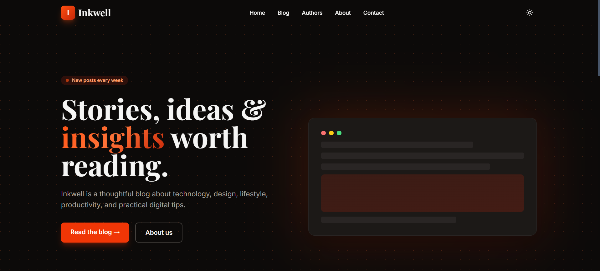
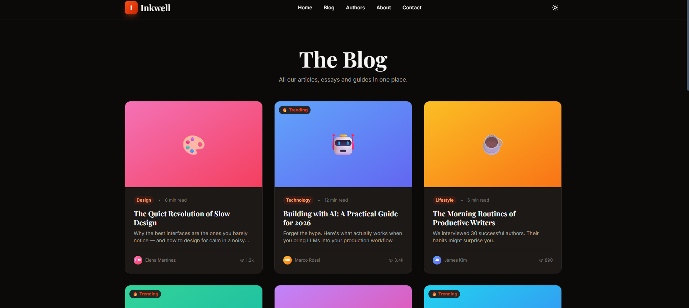
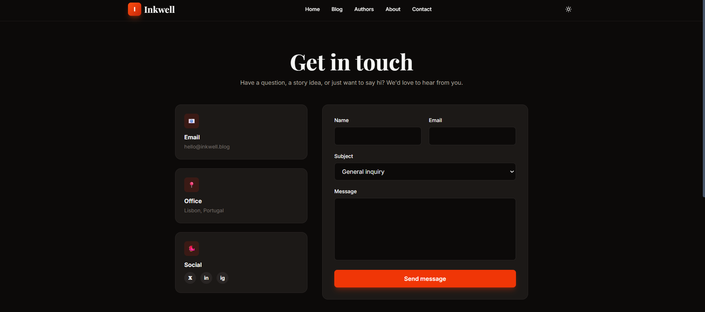
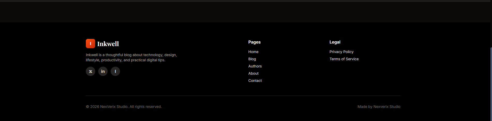
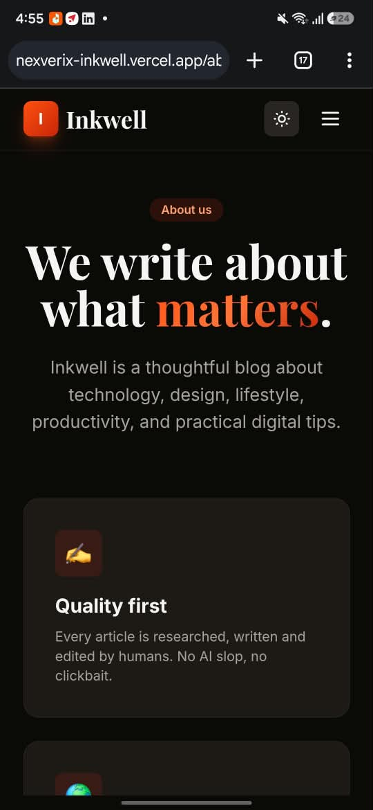

# Inkwell — Modern Static Blog | NexVerix Studio

**Inkwell** is a fast, SEO-optimized, multi-page static blog engine engineered and maintained under the **[NexVerix](https://github.com/NexVerix)** software ecosystem.

Instead of relying on heavy frameworks or databases, Inkwell utilizes a lightweight, custom Node.js script to generate clean, production-ready HTML pages from a single structured data file.

Deployed seamlessly on Vercel under the NexVerix infrastructure, Inkwell is designed for writers and developers who want full control over their content, excellent SEO, and lightning-fast loading times.

---

## Key Features

- **Blazing Fast:** Pure static HTML, CSS, and JavaScript with zero client-side rendering overhead.
- **SEO Optimized:** Automatically generates unique meta tags, Open Graph data, Twitter Cards, canonical URLs, and JSON-LD structured data for every page.
- **Clean URLs:** Uses the folder/index.html pattern (e.g., `/blog`, `/posts/my-article`) for professional, search-engine-friendly routing.
- **Dark Mode:** Built-in, system-aware dark mode with smooth transitions and modern UI standards.
- **Fully Responsive:** Beautiful, mobile-first design powered by Tailwind CSS.
- **Frictionless Content Management:** Add new posts, authors, or categories by simply editing the centralized `site-data.js` file.
- **Working Contact Form:** Ready-to-use Formspree integration for static infrastructure.
- **Automatic Sitemap & Robots.txt:** Automatically generates sitemap and robots.txt files to help search engines crawl and index your content.

---


## Screenshots

### Home Page (Dark Mode)


### Blog Post Page


### Contact Page 


### Footer Section 


### Mobile Responsive Design
<div align="center">
  
  <p><em>Inkwell — Responsive Mobile Experience</em></p>
</div>

---

## Technical Stack

| Component | Technology |
|---|---|
| Parent Studio | [NexVerix](https://github.com/NexVerix) |
| Generator | Node.js (Native `fs` and `path` modules) |
| Styling | Tailwind CSS (CDN) + Custom CSS |
| Typography | Inter & Playfair Display |
| Hosting | Vercel |
| Version Control | Git & GitHub |
| Deployment | Vercel CI/CD |

---

## Project Structure

```text
inkwell/
├── assets/
│   ├── style.css          # Custom CSS overrides and dark mode styles
│   ├── script.js          # Client-side JavaScript (theme toggle, smooth scroll)
│   └── favicon.svg        # NexVerix ecosystem branding icon
│
├── dist/                  # Generated static output (ignored by Git)
│
├── generate-site.js       # Core Node.js static site generator
├── site-data.js           # Centralized content: posts, authors, configurations
├── package.json           # Dependencies and build scripts
└── README.md              # Project documentation
```

---

## Getting Started

Follow these steps to set up Inkwell locally.

### 1. Clone the Repository

```bash
git clone https://github.com/NexVerix/inkwell.git
cd inkwell
```

### 2. Install Dependencies

```bash
npm install
```

### 3. Build the Website

Generate the static website by running:

```bash
npm run build
```

This command generates the production-ready website inside the `dist/` directory.

### 4. Run Locally

Serve the generated website using a local development server:

```bash
npx serve dist
```

Open the following URL in your browser:

```text
http://localhost:3000
```

---

##  How to Add Content

Inkwell makes content management simple. You don't need to manually create HTML pages.

### Adding a New Blog Post

1. Open the `site-data.js` file.
2. Locate the `posts` array.
3. Add a new post object containing the following information:
   - `title`
   - `slug`
   - `content` (HTML format)
   - `authorId`
   - SEO metadata
4. Save your changes.
5. Run the build command:

```bash
npm run build
```

6. Preview the generated website locally.
7. Commit and push your changes to GitHub.

Vercel will automatically deploy the updated website.

---

## Deployment & Infrastructure

Inkwell is configured for continuous deployment using **Vercel** under the NexVerix organization.

### Deployment Workflow

1. Push your latest changes to the GitHub repository:
   `NexVerix/inkwell`
2. Import the repository into Vercel.
3. Configure the following build settings:

| Setting | Value |
|---|---|
| Framework Preset | Other |
| Build Command | `npm run build` |
| Output Directory | `dist` |
| Install Command | `npm install` |

4. Deploy the project.

### Automatic Deployment

Once connected, Vercel automatically builds and deploys the website whenever changes are pushed to the configured GitHub branch.

**Production Infrastructure:** [Vercel](https://vercel.com/)

---

## SEO & Performance

Inkwell is designed with search engine visibility and performance in mind.

Its static generation architecture provides:

- Search-engine-friendly HTML pages.
- Unique metadata for individual blog posts.
- Open Graph integration for social media sharing.
- Twitter Card metadata.
- Canonical URLs.
- JSON-LD structured data.
- Automatically generated XML sitemap.
- Robots.txt configuration.
- Lightweight pages with minimal JavaScript overhead.

---

## Contributing

Contributions, suggestions, and improvements are welcome!

To contribute:

1. Fork the repository.
2. Create a new feature branch.
3. Make your changes.
4. Test the static site generator.
5. Submit a pull request.

Please ensure that your changes maintain the project's lightweight architecture and coding standards.

---

## License

Inkwell is developed and maintained by **NexVerix Studio**.

This project is open-source and distributed under the **MIT License**.

---

## About NexVerix

**NexVerix** is the parent software ecosystem behind Inkwell, focused on building modern, lightweight, and practical software solutions.

Explore more projects:

**GitHub:** [https://github.com/NexVerix](https://github.com/NexVerix)

---

<p align="center">
  <strong> Inkwell — Write. Publish. Grow.</strong>
  <br>
  Built with by NexVerix Studio.
</p>
